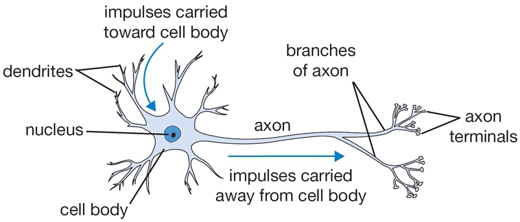
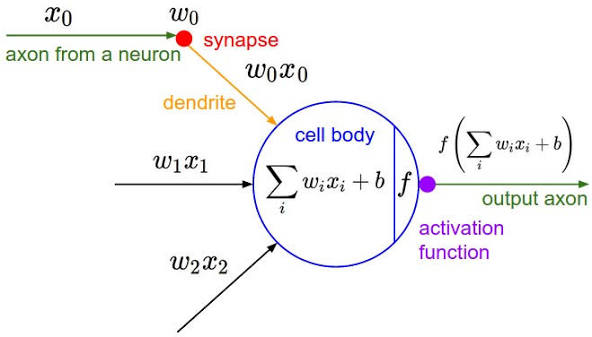
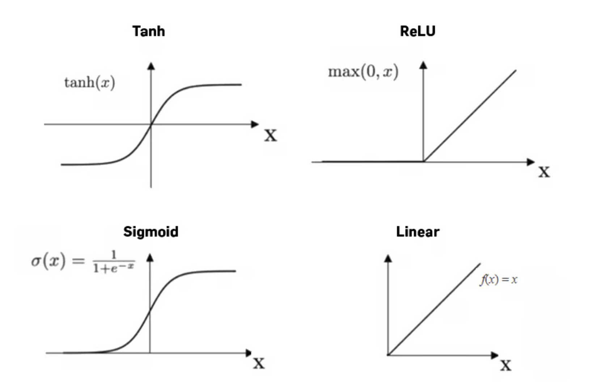
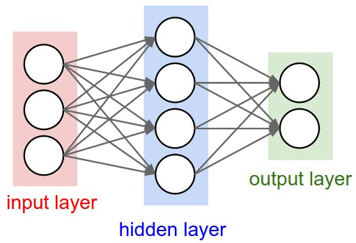
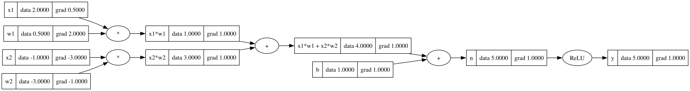
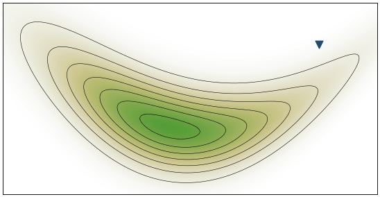
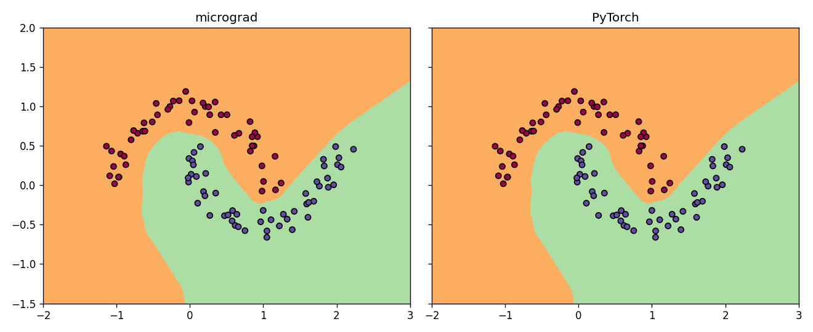

# 01 – micrograd

micrograd is a tiny autograd engine: about 100 lines that build a graph of math operations and backpropagate through it. On top of it sits a small neural network library. It works like PyTorch, only on single numbers (scalars) instead of tensors, so every step stays readable.

| File | What's in it |
| --- | --- |
| [engine.py](engine.py) | `Value`: a scalar that remembers how it was computed and can backpropagate |
| [nn.py](nn.py) | `Neuron`, `Layer`, `MLP` built from `Value`s |
| [graph.py](graph.py) | `draw_dot`: renders the computation graph as an SVG |
| [demo.py](demo.py) | the same MLP trained in micrograd and in PyTorch, and a plot of what each one learned |

Run the scripts from inside `01-micrograd/`. `graph.py` also needs the Graphviz program itself, not just the Python package (`brew install graphviz` on macOS).

---

## 1. A neural network is just a mathematical expression

Strip away the biology and a neural network is a big mathematical function. It takes the input data and a set of **parameters** (weights and biases) and produces an output:

$$
\hat{y} = f_\theta(x)
$$

"Learning" means adjusting the parameters $\theta$ until the outputs are good. To know *which way* to adjust each parameter, we need its derivative with respect to the error, and computing that derivative is the job of micrograd.

## 2. The neuron

The idea is borrowed loosely from biology. A neuron collects signals through its dendrites, combines them in the cell body, and fires a signal down its axon.



The mathematical model keeps the same structure:



$$
y = f\Big(\sum_{i} w_i x_i + b\Big)
$$

- $x_i$: the **inputs**
- $w_i$: the **weights**, i.e. how strongly each input counts (the "synapse strength")
- $b$: the **bias**, which shifts the threshold so the neuron can fire even when all inputs are 0, or stay quiet when they're large
- $f$: the **activation function**, which squashes or clips the result

In [nn.py](nn.py):

```python
act = sum((wi*xi for wi, xi in zip(self.w, x)), self.b)   # Σ wᵢxᵢ + b
return act.relu() if self.nonlin else act                 # f(...)
```

## 3. Activation functions



**Why we need them:** without a nonlinearity, stacking layers gets you nothing. A linear function of a linear function is still linear, so a 10-layer network would be no more powerful than a single layer.

micrograd uses **ReLU** in the hidden layers. The **last layer is linear**, so the output can take any value.

## 4. Multi-layer perceptron (MLP)

Neurons are grouped into **layers**, and every neuron in a layer is connected to every output of the previous layer ("fully connected").



- **Input layer**: just the data, no computation
- **Hidden layers**: the neurons in between
- **Output layer**: the final prediction

For a whole layer, the neuron formula becomes a matrix product:

$$
h^{(l)} = f\big(W^{(l)} h^{(l-1)} + b^{(l)}\big)
$$

In micrograd:

```python
from nn import MLP

model = MLP(3, [4, 4, 1])   # 3 inputs → 4 → 4 → 1 output
len(model.parameters())     # (3+1)·4 + (4+1)·4 + (4+1)·1 = 41
```

## 5. Loss function

The loss is one number that says how wrong the network is. Training means making it small.

**Mean squared error**, for regression:

$$
L = \frac{1}{N}\sum_{n=1}^{N} \big(\hat{y}_n - y_n\big)^2
$$

## 6. Forward pass

The forward pass computes the output from the input. In micrograd, every operation on a `Value` also records **where it came from**: its children (`_prev`) and the operation (`_op`). By the end, the forward pass has built a graph of the whole expression.

Here's a single ReLU neuron with two inputs, drawn with `draw_dot`. Each box shows a value's label, its `data` from the forward pass, and its `grad` from the backward pass in the next section:



$$
y = \mathrm{ReLU}(x_1 w_1 + x_2 w_2 + b) = \mathrm{ReLU}(2 \cdot 0.5 + (-1)(-3) + 1) = 5
$$

## 7. Backward pass (backpropagation)

The backward pass computes $\frac{\partial L}{\partial w}$ for every parameter: how much the loss changes if we nudge that parameter a little.

It's just the **chain rule**, applied node by node from the output backwards:

$$
\frac{\partial L}{\partial a} = \frac{\partial L}{\partial c} \cdot \frac{\partial c}{\partial a}
$$

Each node only needs to know its own **local derivative**. It multiplies that by the gradient arriving from above (`out.grad`) and passes the result down to its children:

| Operation | Local rule (in `_backward`) |
| --- | --- |
| $c = a + b$ | `a.grad += c.grad`, `b.grad += c.grad`: **addition routes the gradient through unchanged** |
| $c = a \cdot b$ | `a.grad += b.data * c.grad`, `b.grad += a.data * c.grad`: **multiplication swaps the inputs** |
| $c = a^n$ | `a.grad += n * a.data**(n-1) * c.grad` |
| $c = \mathrm{ReLU}(a)$ | `a.grad += (c.data > 0) * c.grad`: the gradient passes only if the neuron was active |

`Value.backward()` then:

1. sorts the graph **topologically**, so a node is processed only after everything that depends on it,
2. sets the output's gradient to $\frac{\partial L}{\partial L} = 1$,
3. calls `_backward()` on every node in reverse order.

For the neuron above, `y.backward()` gives:

| | $w_1$ | $w_2$ | $b$ | $x_1$ | $x_2$ |
| --- | --- | --- | --- | --- | --- |
| $\partial y / \partial \cdot$ | 2.0 | -1.0 | 1 | 0.5 | -3.0 |

So the gradient of a weight is the input it multiplies, and the other way round.

> **Why `+=` and not `=`:** if a value is used in more than one place, gradients flow back to it along several paths, and the chain rule says to **add** them. With `=` the last path would overwrite the others.

## 8. Training: gradient descent

The gradient points in the direction in which the loss *increases*, so we take a small step in the opposite direction:

$$
w \leftarrow w - \eta \, \frac{\partial L}{\partial w}
$$

$\eta$ is the **learning rate** (step size): too big and training jumps around or diverges, too small and it takes forever.

Each step moves the parameters a little further across the contour lines of the loss, until they settle in the optimum:



> **Key idea:** the gradient tells each weight how it affects the loss.
> - $\frac{\partial L}{\partial w} > 0$: increasing $w$ increases the loss, so $w$ gets **smaller**.
> - $\frac{\partial L}{\partial w} < 0$: increasing $w$ decreases the loss, so $w$ gets **bigger**.
> - The larger $\lvert \frac{\partial L}{\partial w} \rvert$, the more influence $w$ has on the loss, and the bigger its step.
>
> So connections that push the output in the right direction are strengthened, and connections that push it in the wrong direction are weakened or flipped. Every weight is adjusted at the same time, each according to its own gradient.

The training loop is always the same four steps:

```python
for step in range(100):
    # 1. forward pass
    preds = [model(x) for x in xs]
    loss = sum((p - y)**2 for p, y in zip(preds, ys))

    # 2. zero the gradients (they accumulate because of +=)
    model.zero_grad()

    # 3. backward pass
    loss.backward()

    # 4. update
    for p in model.parameters():
        p.data -= 0.01 * p.grad
```

> **Don't forget `zero_grad()`.** Because gradients accumulate, skipping it adds this step's gradients on top of the last step's, and the updates become wrong.

## 9. micrograd vs. PyTorch

The concepts map one to one. PyTorch just works on **tensors** (whole arrays at once, on the GPU) instead of single scalars:

| micrograd | PyTorch |
| --- | --- |
| `Value(2.0)` | `torch.tensor(2.0, requires_grad=True)` |
| `MLP(3, [4, 4, 1])` | `nn.Sequential(nn.Linear(3, 4), nn.ReLU(), nn.Linear(4, 4), nn.ReLU(), nn.Linear(4, 1))` |
| `loss.backward()` | `loss.backward()` |
| `p.grad` | `p.grad` |
| `model.zero_grad()` | `optimizer.zero_grad()` |
| `p.data -= lr * p.grad` | `optimizer.step()` |

## 10. Demo: classifying two moons

[demo.py](demo.py) trains a binary classifier on the "two moons" dataset: 100 2D points in two interleaving half circles, labelled $-1$ and $+1$. A straight line can't separate them, so the network has to learn a curved decision boundary.

The setup:

- **Model:** `MLP(2, [16, 16, 1])`, i.e. 2 inputs, two hidden ReLU layers of 16 neurons and one linear output (337 parameters). The sign of the output is the predicted class.
- **Loss:** max-margin loss.
- **Training:** 100 steps of gradient descent on all 100 points at once.

The script does this twice: first with **micrograd**, then with the same network built in **PyTorch** as in section 9. Finally it plots the decision boundary each model learned.

The PyTorch model starts from the same weights as the micrograd model, so if both really compute the same thing, they have to end up in the same place. They do: both classify every point correctly and learn the same decision boundary:



```bash
python demo.py   # takes about a minute, almost all of it the micrograd training
```

---

<sub>`engine.py` and `nn.py` follow Andrej Karpathy's [micrograd](https://github.com/karpathy/micrograd) (MIT license). Neuron and network diagrams: [Stanford CS231n](https://cs231n.github.io/neural-networks-1/).</sub>
