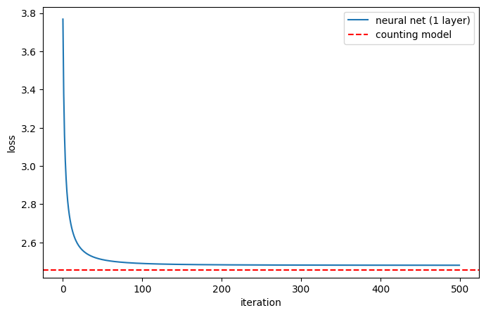
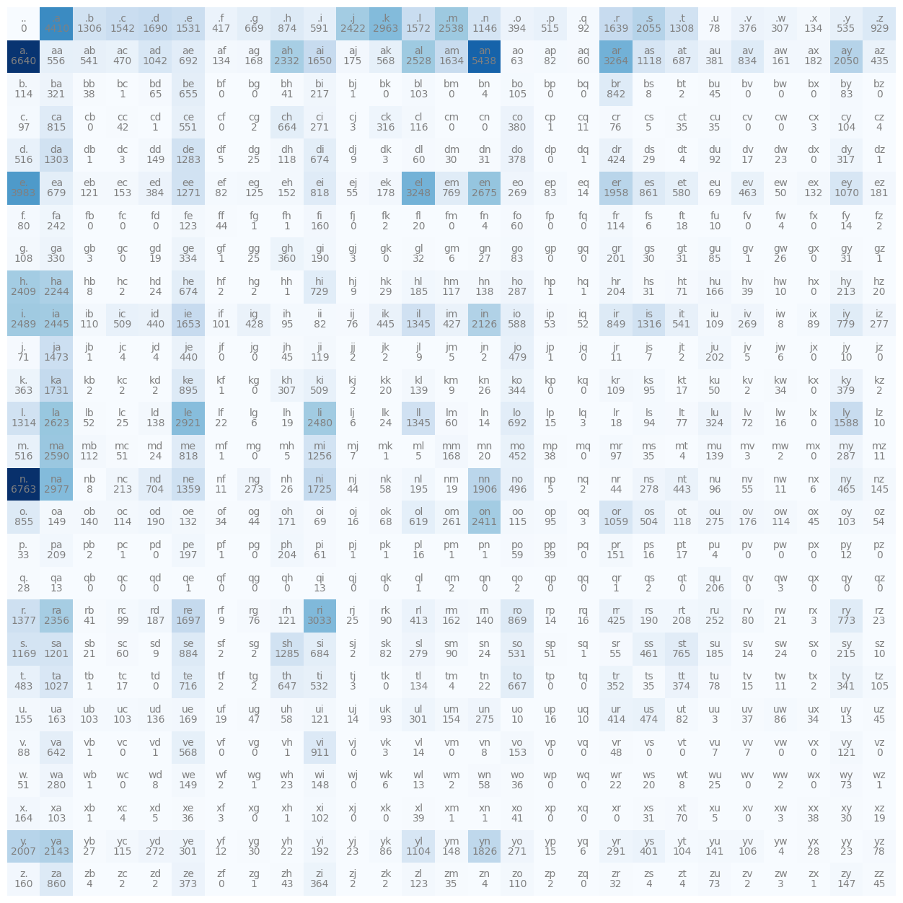
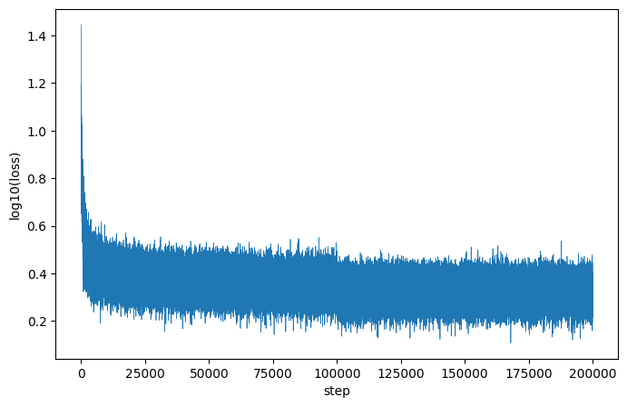
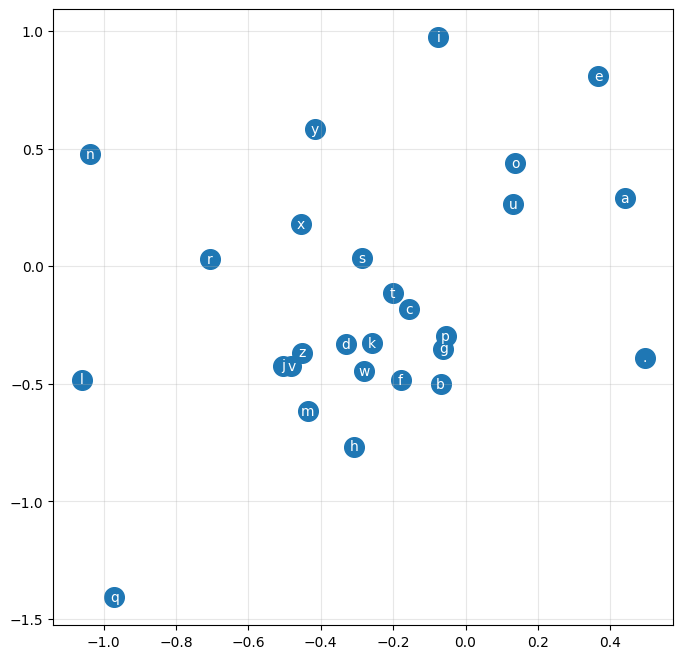

# 02 · makemore: Character-level language models

Character-level language models that generate new, name-like strings, trained on a dataset of 32,033 names.

## Part 1: Bigram language model

The model is a **bigram**: it predicts the next character from only the current one. I built it in two ways that should arrive at the same result:

1. **Counting:** count how often each character follows another, then normalize the counts into probabilities.
2. **Neural net:** a single linear layer (27 neurons, no hidden layer) trained with gradient descent on the same loss.

Both are compared against a **uniform baseline** that picks every character with equal probability.

```bash
# from the repository root
python 02-makemore/bigram.py
```

### Results

| Model | Loss |
|---|---|
| Uniform baseline | 3.2958 |
| Counting model | 2.4546 |
| Neural net (1 layer) | 2.4807 |




**Sampled names** (same random seed for all three):

| Uniform baseline | Counting model | Neural net |
|---|---|---|
| cexzm. | cexze. | cexze. |
| zoglkurkicqzktyhwmvmzimjttainrlkfukzkktda. | momasurailezitynn. | momasurailezityha. |
| sfcxvpubjtbhrmgotzx. | konimittain. | konimittain. |
| iczixqctvujkwptedogkkjemkmmsidguenkbvgynywftbspmhwcivgbvtahlvsu. | llayn. | llayn. |
| dsdxxblnwglhpyiw. | ka. | ka. |
| igwnjwrpfdwipkwzkm. | da. | da. |
| desu. | staiyaubrtthrigotai. | staiyaubrtthrigotai. |
| firmt. | moliellavo. | moliellavo. |
| gbiksjbquabsvoth. | ke. | ke. |
| kuysxqevhcmrbxmcwyhrrjenvxmvpfkmwmghfvjzxobomysox. | teda. | teda. |

The counting model and the neural net produce almost identical names: gradient descent learned the same table that counting produced. Both clearly beat the uniform baseline, whose names are random and far too long.

**Counted vs. learned bigram table.** 

| Counted | Learned by the neural net |
|---|---|
|  |  |

## Part 2: MLP language model

The bigram only sees one character, so its loss can't get much lower. The **MLP** (following Bengio et al., 2003) predicts the next character from the **last 3 characters**:

1. **Embedding:** every character gets a learned vector of 10 numbers, so similar characters end up close together.
2. **Hidden layer:** the 3 embeddings side by side (30 numbers) go through 200 neurons with tanh.
3. **Output layer:** one score per possible next character.

11,897 parameters, trained for 200,000 steps on minibatches of 32 (learning rate 0.1, then 0.01). The names are split 80/10/10 into train, dev and test sets.

```bash
# from the repository root
python 02-makemore/mlp.py
```

### Results

Three characters of context lower the loss from 2.45 to 2.17. Train and dev are close, so the model isn't overfitting yet.



**Sampled names.** As expected, these are the more name-like results than the bigram produced.

| MLP |
|---|
| dexzerioullus. |
| rochi. |
| ahnell. |
| imittain. |
| lucan. |
| kaida. |
| samiyah. |
| javarii. |
| tai. |
| moziellah. |

**Learned character space.** A 10D embedding can't be plotted, so a second model was trained with a 2D embedding. Without being told anything about letters, it groups the vowels together and places `q` and `.` far away from everything else.

