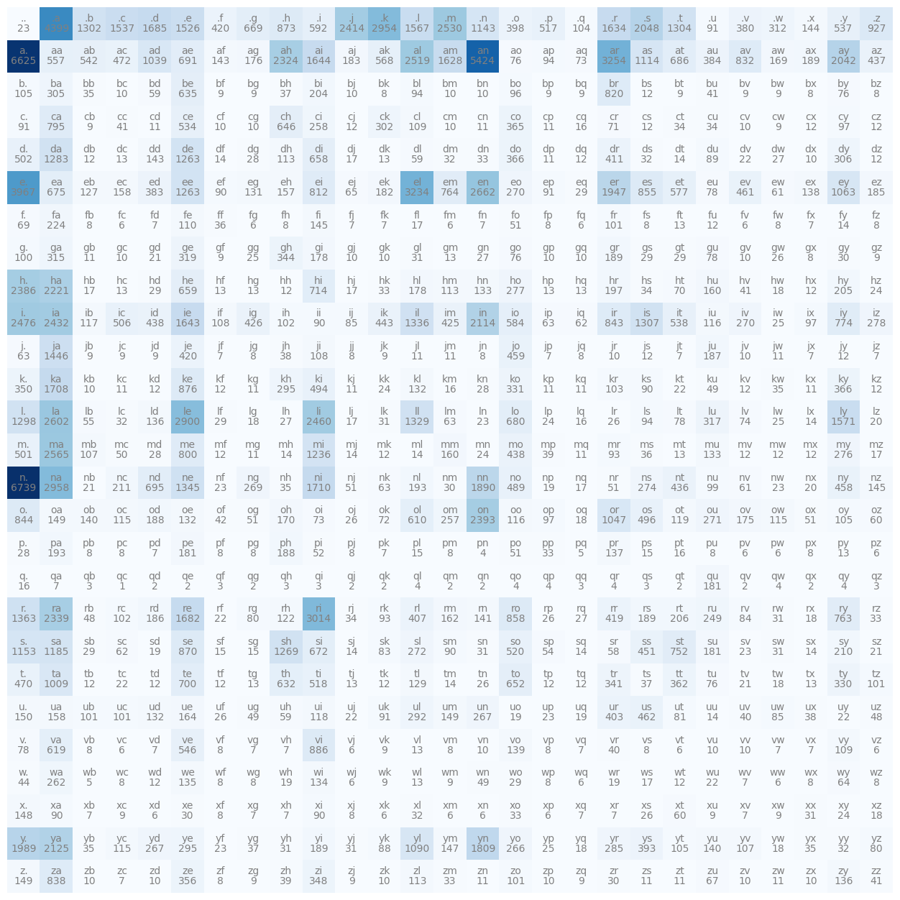

# 02 · makemore part 1: Bigram language model

A character-level language model that generates new, name-like strings, trained on a dataset of 32,033 names.

The model is a **bigram**: it predicts the next character from only the current one. I built it in two ways that should arrive at the same result:

1. **Counting:** count how often each character follows another, then normalize the counts into probabilities.
2. **Neural net:** a single linear layer (27 neurons, no hidden layer) trained with gradient descent on the same loss.

Both are compared against a **uniform baseline** that picks every character with equal probability.

```bash
# from the repository root
python 02-makemore/bigram.py
```

## Results

| Model | Loss |
|---|---|
| Uniform baseline | 3.2958 |
| Counting model | 2.4546 |
| Neural net (1 layer) | 2.4807 |


**Sampled names** (same random seed for all three):

| Uniform baseline | Counting model | Neural net |
|---|---|---|
| cexzm. | cexze. | cexze. |
| zoglkurkicqzktyhwmvmzimjttainrlkfukzkktda. | momasurailezitynn. | momasurailezityha. |
| sfcxvpubjtbhrmgotzx. | konimittain. | konimittain. |
| iczixqctvujkwptedogkkjemkmmsidguenkbvgynywftbspmhwcivgbvtahlvsu. | llayn. | llayn. |
| dsdxxblnwglhpyiw. | ka. | ka. |
| igwnjwrpfdwipkwzkm. | da. | da. |
| desu. | staiyaubrtthrigotai. | staiyaubrtthrigotai. |
| firmt. | moliellavo. | moliellavo. |
| gbiksjbquabsvoth. | ke. | ke. |
| kuysxqevhcmrbxmcwyhrrjenvxmvpfkmwmghfvjzxobomysox. | teda. | teda. |

The counting model and the neural net produce almost identical names: gradient descent learned the same table that counting produced. Both clearly beat the uniform baseline, whose names are random and far too long.

**Counted vs. learned bigram table.** 

| Counted | Learned by the neural net |
|---|---|
|  |  |