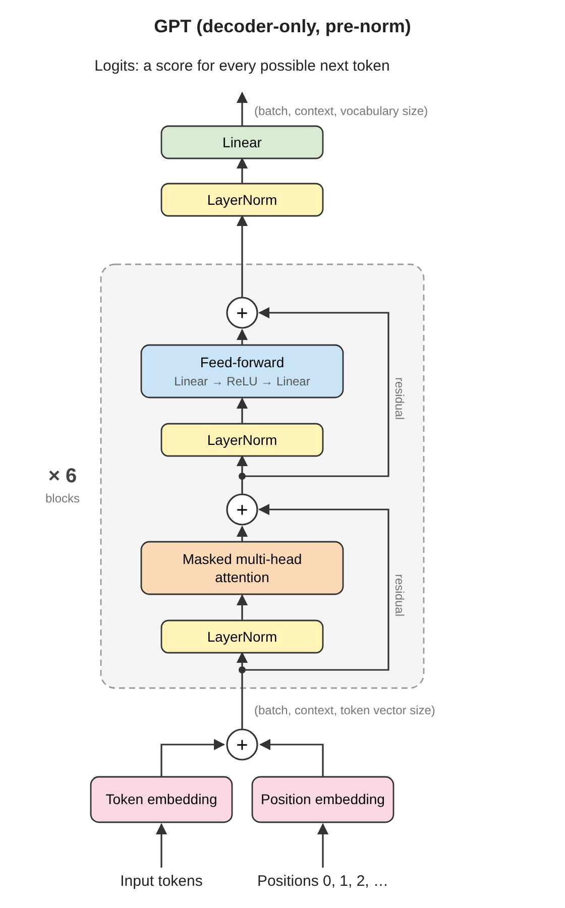
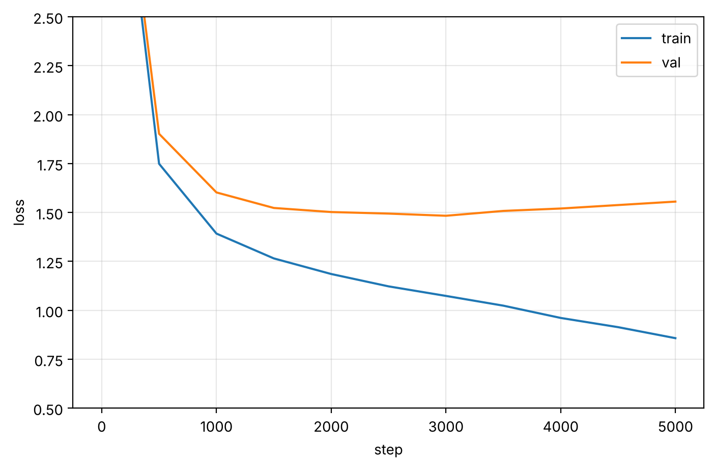

# 03 · GPT: A decoder-only transformer

A GPT-style language model that writes Shakespeare-like text, character by character. It's a **decoder-only transformer** with 10.8M parameters, trained on about 1 million characters of Shakespeare (`input.txt`).

```bash
# from the repository root
python 03-gpt/gpt.py
```

## Architecture

Like the decoder in *Attention Is All You Need*, but without the encoder and with the LayerNorm before each sub-layer instead of after it (pre-norm):



## Attention

Attention is the only place where tokens exchange information. Every token is represented by a vector $x$. From it, three learned weight matrices compute three smaller vectors, whose size is called the head size:

$$q = x \cdot W_Q, \qquad k = x \cdot W_K, \qquad v = x \cdot W_V$$

- **Query** $q$: "what am I looking for?"
- **Key** $k$: "what do I contain?"
- **Value** $v$: "what I pass on if someone attends to me"

How much token $i$ attends to token $j$ is given by the dot product of $i$'s query with $j$'s key: the better they match, the more of $j$'s value flows into $i$. Since $W_Q$, $W_K$ and $W_V$ are learned, the model itself decides which tokens should match.

For all tokens at once, with the rows of $Q$, $K$ and $V$ holding the vectors of every token:

$$\text{Attention}(Q,K,V) = \text{softmax}\!\left(\frac{QK^\top}{\sqrt{d_k}} + M\right)V$$

where $d_k$ is the head size and $M$ is the causal mask.

### A worked example

Three tokens with hand-picked vectors and a head size of 2. (Words for readability; in this model the tokens are characters.)

| Token | Query $q$ | Key $k$ | Value $v$ |
|---|---|---|---|
| The | (1, 0) | (1, 0) | (1, 0) |
| cat | (0, 1) | (1, 1) | (0, 1) |
| sat | (1, 1) | (0, 1) | (1, 1) |

**1. Scores:** every query against every key, scaled by the square root of the head size. Row $i$ = how much token $i$ is interested in each token.

$$\frac{QK^\top}{\sqrt{2}} = \frac{1}{\sqrt{2}}\begin{bmatrix} 1 & 1 & 0 \\ 0 & 1 & 1 \\ 1 & 2 & 1 \end{bmatrix} = \begin{bmatrix} 0.71 & 0.71 & 0 \\ 0 & 0.71 & 0.71 \\ 0.71 & 1.41 & 0.71 \end{bmatrix}$$

**2. Causal mask:** set everything above the diagonal to $-\infty$. A token may only look at itself and earlier tokens, because the later ones are what it's trying to predict.

$$\begin{bmatrix} 0.71 & -\infty & -\infty \\ 0 & 0.71 & -\infty \\ 0.71 & 1.41 & 0.71 \end{bmatrix}$$

**3. Softmax per row:** turns the scores into weights that sum to 1. The $-\infty$ entries become exactly 0.

$$\begin{bmatrix} 1 & 0 & 0 \\ 0.33 & 0.67 & 0 \\ 0.25 & 0.50 & 0.25 \end{bmatrix}$$

"sat" attends most to "cat" (0.50), because its query matches cat's key best.

**4. Weighted sum of the values:** each token's output is a mix of the values it attends to. For "sat":

$$0.25 \cdot (1, 0) + 0.50 \cdot (0, 1) + 0.25 \cdot (1, 1) = (0.50,\ 0.75)$$

### Why scale by the square root of the head size?

A dot product sums one product per dimension, so the larger the head size, the larger the scores get. Without the scaling, the softmax puts almost all weight on a single token, and the gradients through it vanish.

### Multi-head attention

Each block runs several heads in parallel, each with its own weight matrices, and concatenates their outputs back to the size of the token vector. Different heads can learn different patterns, e.g. one looks at the previous character, another at the start of the current word.

Shapes for one head:

```
input:    (batch, context, token vector size)
Q, K, V:  (batch, context, head size)
scores:   (batch, context, context)
output:   (batch, context, head size)
```

## LayerNorm, feed-forward and residual connections

**LayerNorm** normalizes each token's vector to mean 0 and variance 1 over its own entries, then applies a learned scale $\gamma$ and shift $\beta$:

$$\text{LayerNorm}(x) = \gamma \cdot \frac{x - \mu}{\sqrt{\sigma^2 + \epsilon}} + \beta$$

It keeps the activations in a stable range across many blocks. Unlike BatchNorm, it doesn't depend on the other examples in the batch, so it behaves the same during training and when generating a single token.

**Feed-forward** is a small MLP applied to every token separately, with the same weights for all of them. It expands the vector to 4× its size, applies ReLU, and projects it back:

$$\text{FFN}(x) = W_2 \cdot \text{ReLU}(W_1 x + b_1) + b_2$$

Attention moves information between tokens, mostly as weighted averages; the feed-forward is where each token processes what it has gathered.

**Residual connections:** both sub-layers add their result to the token's vector instead of replacing it:

$$x = x + \text{Attention}(\text{LayerNorm}(x)), \qquad x = x + \text{FFN}(\text{LayerNorm}(x))$$

Since the gradient passes through a $+$ unchanged, it reaches the early blocks directly, which is what makes deep stacks trainable.

## Results

Configuration: 6 layers, 6 heads, embedding size 384, context 256, batch 64, AdamW with learning rate 3e-4, 5,000 steps. Trained on a MacBook Air GPU (MPS) in **3.5 hours**.



**Generated text example**:

```
The Margaret:
Wherein are the edge before they lay
Myself or this statue and the love? Yet, my lord,
Or else I would lad thou wert they and to have her,
So I; my lord, take not my refession and prove,
Excepture who, like a season of great war,
And wondrous success dreams to look upon you.

ANGELO:
Yet were teach of them;
For they are tender to rise beauty against to have
Bids them from Aueenar child by again.

ANGELO:
Affrighted that would avoid it, conscience to stand.

LUCIO:
Let me speak.
```

The model has learned the form of a play (speaker names, line breaks, verse) and mostly real English words, but not their meaning.

## Where the parameters and the compute sit

| Component | Parameters | Share |
|---|---|---|
| Attention (Q, K, V, projection), 6 layers | 3,541,248 | 32.8% |
| Feed-forward, 6 layers | 7,089,408 | 65.7% |
| Embeddings, LayerNorms, output layer | 158,273 | 1.5% |
| **Total** | **10,788,929** | |

Two thirds of the weights sit in the feed-forward layers. Since generating a token means multiplying with every weight once, they also take about two thirds of the compute and memory traffic per token.

The cost of the attention scores doesn't depend on the number of weights, but on the context length. Each new token is compared with all $T$ previous tokens, so over a whole sequence of $T$ tokens the cost grows with $T^2$.