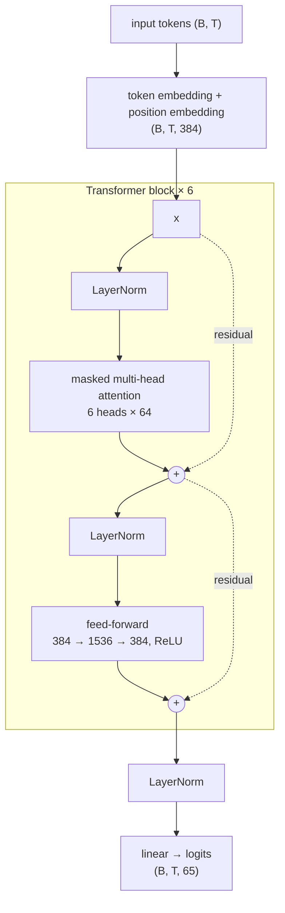

# 03 · GPT: A decoder-only transformer

A GPT-style language model that writes Shakespeare-like text, character by character. It's a **decoder-only transformer** with 10.8M parameters, trained on about 1 million characters of Shakespeare (input.txt).

```bash
# from the repository root
python 03-gpt/gpt.py
```

## Architecture

Unlike the encoder-decoder model in *Attention Is All You Need*, a GPT only has the decoder part. It also uses **pre-norm**: each sub-layer normalizes its input and adds its result back to it (`x = x + sublayer(LayerNorm(x))`), instead of normalizing after the addition.



Attention is where tokens exchange information, the feed-forward layer is where each token processes it on its own. The residual connections give gradients a direct path back to the early layers.

## Attention

$$\text{Attention}(Q,K,V) = \text{softmax}\!\left(\frac{QK^\top}{\sqrt{d_k}} + M\right)V$$

- **Query, key, value:** each token emits a query ("what am I looking for?"), a key ("what do I contain?") and a value ("what I pass on"). The dot product of a query with a key decides how much one token attends to another.
- **Causal mask $M$:** $-\infty$ above the diagonal, so after the softmax a token gets zero weight on later tokens. It can't look at the future it's supposed to predict.
- **Scaling by $\sqrt{d_k}$:** without it, the dot products grow with the head size, the softmax saturates into an almost one-hot distribution, and the gradients vanish.

Shapes for one head, with batch $B$, context $T$ and head size $d_k = 64$:

```
x (B, T, 384) → Q, K, V (B, T, 64) → scores QKᵀ (B, T, T) → output (B, T, 64)
```

## Results

Configuration: 6 layers, 6 heads, embedding size 384, context 256, batch 64, AdamW with learning rate 3e-4, 5,000 steps. Trained on a MacBook Air GPU (MPS) in **3.5 hours**.


**Generated text example**:

```
The Margaret:
Wherein are the edge before they lay
Myself or this statue and the love? Yet, my lord,
Or else I would lad thou wert they and to have her,
So I; my lord, take not my refession and prove,
Excepture who, like a season of great war,
And wondrous success dreams to look upon you.

ANGELO:
Yet were teach of them;
For they are tender to rise beauty against to have
Bids them from Aueenar child by again.

ANGELO:
Affrighted that would avoid it, conscience to stand.

LUCIO:
Let me speak.
```

The model has learned the form of a play (speaker names, line breaks, verse) and mostly real English words, but not their meaning.

## Where the parameters and the compute sit

| Component | Parameters | Share |
|---|---|---|
| Attention (Q, K, V, projection), 6 layers | 3,541,248 | 32.8% |
| Feed-forward, 6 layers | 7,089,408 | 65.7% |
| Embeddings, LayerNorms, output layer | 158,273 | 1.5% |
| **Total** | **10,788,929** | |

Two thirds of the weights sit in the feed-forward layers. Since generating a token means multiplying with every weight once, they also take about two thirds of the compute and memory traffic per token.

The cost of the attention scores doesn't depend on the number of weights, but on the context length. Each new token is compared with all $T$ previous tokens, so over a whole sequence of $T$ tokens the cost grows with $T^2$.
